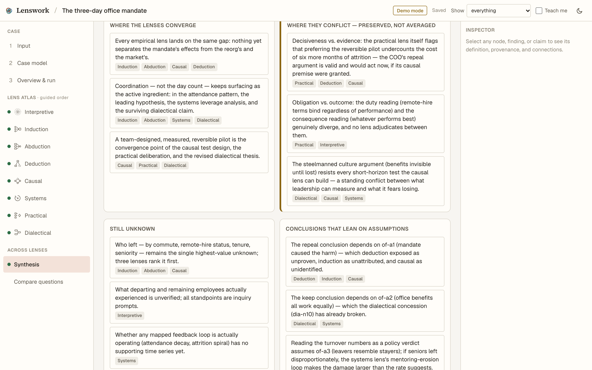
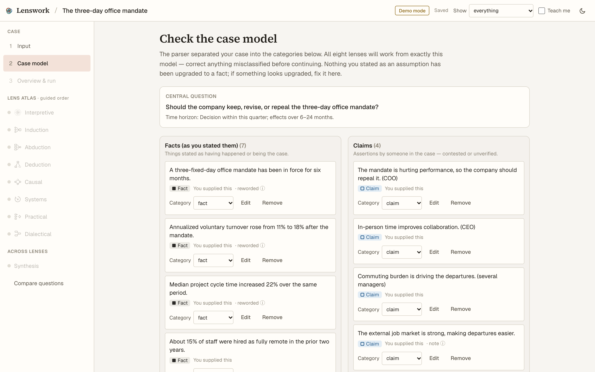
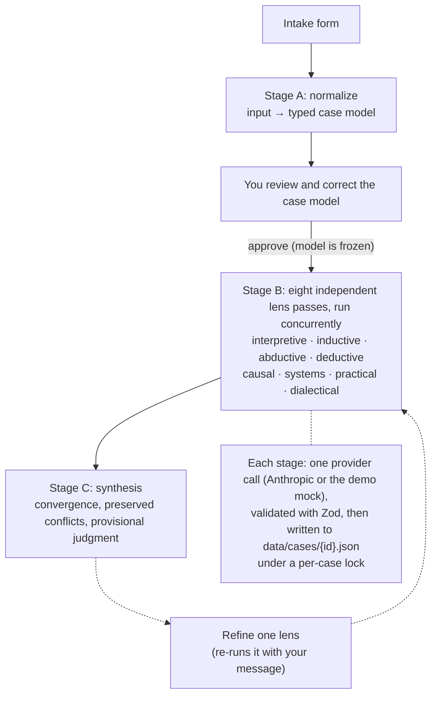

# lenswork

A local web app that takes one case (a decision, an argument, a policy, a puzzling result) and analyzes it through eight distinct reasoning lenses, labeling every claim by what kind of claim it is.




## Why I built this

Most analysis of a hard decision runs through one default way of reasoning and quietly drops the others. I wanted to enter a case once and see it examined through eight distinct reasoning lenses side by side. I wanted every claim labeled by what kind of claim it is, so an inference can't pass for a fact. And I wanted a synthesis that keeps the disagreements visible instead of averaging them into one confident answer. The design idea is that each lens is a separate, independent pass over the same corrected case model, so the lenses can't talk each other into agreement before the synthesis.

## What it does

- Takes a case through an intake form with three required fields (title, narrative, central question) and optional structure: known facts, claims, stakeholders, constraints, possible actions, suspected causes, assumptions, values.
- Parses the case into a case model of typed items (facts, claims, assumptions, values, unknowns, constraints) plus stakeholders and options. You edit, add or remove items before any analysis runs.
- Runs eight lenses concurrently against the approved model: interpretive & phenomenological, inductive, abductive, deductive, causal, systems, practical & moral, and dialectical. Each lens has its own diagram type (argument map, hypothesis tree, causal graph, causal-loop diagram, and so on) and a full text equivalent.
- Labels every item with one of seven epistemic types: user fact, user claim, assumption, model inference, value judgment, unknown, or external source. The type is shown by shape and line style as well as color, and every item traces back to the input.
- Writes a synthesis with a convergence matrix (which lenses support which claim), a separate "where they conflict" section, and a provisional judgment with explicit "revise if" conditions.
- Lets you pick the model and depth for each stage, and shows a cost estimate before you run.
- Gives each lens a refine box: challenge a finding or correct a premise, and that lens re-runs with its revision history kept.
- Stores cases as local JSON files and needs no account. A demo mode runs three seeded cases with no API key.

## Use cases

- Stress-testing a decision memo before it goes to leadership: which premises it depends on, what it assumes about cause and effect, and where its values are doing the work.
- Running a pre-mortem on a launch, using the causal, systems and dialectical lenses to find the second-order effects and the objections that survive.
- Examining a policy argument from several angles, for example a congestion charge or a school phone ban (two of the demo cases).
- Working through a puzzling result in research or operations data, keeping several explanations alive and finding the observation that would tell them apart.

## Quick start

lenswork runs on your own computer. There's no account to create and nothing to deploy, and it works without an API key.

### 1. Requirements

- **Git** and **Node.js 20.9 or newer** (check with `node --version`). Get Node from https://nodejs.org if you don't have it. I verified it on Node 26.7.0 with npm 11.19.0, on macOS 15.8.
- Optional: an Anthropic API key, only if you want real analysis instead of demo mode.

### 2. Download

```bash
git clone https://github.com/more-reese/lenswork.git
```

```bash
cd lenswork
```

(No Git? On the GitHub page, use **Code → Download ZIP**, unzip it, and open a terminal in the unzipped folder.)

### 3. Install

```bash
npm ci
```

This takes a minute or two the first time.

### 4. Run

```bash
npm run dev
```

Leave that terminal open and go to http://localhost:3000 in your browser. The header badge says **Demo mode**, which means no API key is configured and nothing leaves your computer.

### 5. Try it

1. On the home page, click **The three-day office mandate**.
2. Click **Parse the case**, then **Looks right — continue to analysis**.
3. Click **Run all eight lenses**. In demo mode this takes a few seconds.
4. Open any lens in the left menu, then **Synthesis**.

Your cases are saved as JSON files in `data/cases/` inside the project folder. Stop the app any time with Ctrl+C.

### Other commands

Production build and server:

```bash
npm run build
```

```bash
npm start
```

Tests and lint:

```bash
npm test
```

```bash
npm run lint
```

`npm test` runs 38 Vitest unit tests: schema acceptance and rejection, referential integrity, mock determinism, trace resolution, layout sanity (including an 80-node stress diagram), and prompt-contract checks. `npm run e2e` runs a Playwright test of the full journey in forced demo mode. See the limitations below before running it.

### Using your own Anthropic API key (real analysis)

1. Create the config file from the template:

   ```bash
   cp .env.example .env
   ```

2. Open `.env` in a text editor and paste your key after the `=`, with no spaces or quotes: `ANTHROPIC_API_KEY=sk-ant-...`
3. **Restart the app** (Ctrl+C, then `npm run dev`). Next.js only reads `.env` at startup.
4. Reload the page. The header badge should now say **Live analysis**.

`.env` is git-ignored, so your key is never committed. It's read on the server only and never sent to the browser. With a key, case text is sent to the Anthropic API; the intake form says so.

**If the first real run fails with "This API key is not scoped to a workspace":** your key is a user-level key (it starts with `sk-ant-usr-`). Either create a key inside a workspace in the [Anthropic Console](https://console.anthropic.com) and use that, or keep the key and add your workspace ID to `.env` as `ANTHROPIC_WORKSPACE_ID=...`, then restart.

| Variable | Required | What it does |
| --- | --- | --- |
| `ANTHROPIC_API_KEY` | No | Enables real analysis. Read on the server only; never sent to the browser. |
| `ANTHROPIC_WORKSPACE_ID` | No | Only for user-level keys that aren't scoped to a workspace; sent as the `anthropic-workspace-id` header. |
| `LENSWORK_FORCE_MOCK` | No | Set to `1` to force demo mode even when a key is present. The e2e test uses this. |

With a key present, the header badge switches from Demo mode to Live analysis. Models and depth are set under **Analysis settings** on the intake form.

### Running without an API key

Demo mode uses a deterministic mock provider, and nothing leaves the machine. The home page offers three demo cases:

- **The three-day office mandate** has fully curated analyses across all eight lenses and a curated synthesis. It's the one to look at.
- **Congestion pricing downtown** and **Phones out of the school day** have curated inputs and case models. Their lens analyses come from a deterministic generic builder.
- **Your own cases** get structural templates that organize your input honestly but do no real reasoning. Real analysis needs a key.

The full flow works in demo mode: parse, correct the case model, run all eight lenses, synthesize, refine.

## How it works



The browser drives the pipeline. `src/lib/store.ts` (Zustand) calls `/api/analyze` once per stage and fires the eight lens requests together with `Promise.allSettled`, so one failing lens doesn't stop the others. `src/app/api/analyze/route.ts` runs a single stage per request: the model call happens outside the case's write lock, and the read-modify-write of the case file happens inside it.

The contract is in `src/lib/schema/index.ts` (Zod schemas for the case model, diagrams, lens analyses and synthesis). Provider code is in `src/lib/llm/`: `provider.ts` is the interface, `anthropic.ts` the real provider, `mock/` the demo data, and `prompts.ts` the normalization, lens, synthesis, refine and repair prompts. Lens metadata and the teaching content are in `src/lib/lenses/registry.ts`, the epistemic visual language is in `src/lib/epistemic.ts`, and each lens has its own view in `src/components/lens/views/`. [`docs/design-rationale.md`](docs/design-rationale.md) covers the visual semantics and accessibility choices.

## Design decisions

**A correction checkpoint before anything runs.** Normalization turns your input into typed items, and the lenses don't run until you approve that case model. A misread fact or a claim filed as a fact would otherwise be reasoned about eight times over, and garbage in multiplies by eight. The cost is an extra step before you see results, and re-parsing the case resets the approval.

**Eight independent passes, not one long prompt.** Each lens gets the same frozen case model and only its own method, and the passes run concurrently. Lenses can't quietly converge. Each lens names what it can't settle and which lens should take it up; sending that handoff re-runs the other lens with the finding phrased as a question, not a fact. The cost is roughly eight times the calls and tokens of a single analysis, and a per-case write lock to stop eight concurrent writers from losing updates to the same JSON file.

**Every claim carries an epistemic label and a trace.** Items are typed (user fact, user claim, assumption, model inference, value judgment, unknown, external source) in the schema, the prompts and the UI. Rewritten items keep the user's original text, and every inspector view ends in "Traces to". The goal is output you can check rather than trust. The cost is a large schema and more validation failures from the model, which is why there's a repair step.

**The synthesis preserves disagreement.** It reports where the lenses converge, where they conflict (kept separate, not averaged), what remains unknown, and a provisional judgment with the conditions that would overturn it. The cost is a less decisive answer; that's the point, but it's still a cost if you wanted a verdict.

**Model choice per stage, with the cost shown first.** Parsing, lenses and synthesis each take their own model (Haiku 4.5, Sonnet 5.5 or Opus 5.5; the defaults are Sonnet for parsing and Opus for lenses and synthesis), and the intake form shows an estimated cost for the full run before you start. This makes cost against quality an explicit choice. The cost is that the estimate is a heuristic (about 3.8 characters per token, with prices cached in September 2026), not a quote, and actual usage isn't tracked.

**Structured output validated twice.** Every model response is constrained to a Zod schema through Anthropic structured outputs, then re-validated with Zod and checked for referential integrity, such as diagram edges pointing at nodes that exist. On failure, the call is retried once with the exact errors in context. The cost is extra latency and tokens on bad responses, and a hard error after the second failure.

## Limitations and known issues

From [`docs/limitations.md`](docs/limitations.md), plus what I hit while preparing this release:

- No export yet: no PDF or HTML report and no SVG or PNG diagrams. The case JSON in `data/cases/` is the complete record.
- No general undo. Case-model edits are logged and lens revisions are kept, but there's no undo stack.
- In demo mode, only the office-mandate case has curated analyses. Everything else gets structural templates.
- Evidence links are stored, not fetched, and citations aren't bound to individual claims.
- In the diagrams you can drag nodes, but you can't add or cut causal edges directly. Changes go through the refine box.
- Cost estimates are heuristics, as described above.
- Single-user by design. The API routes are unauthenticated and storage is the local filesystem, so deploying it anywhere reachable by others needs auth and a different store first.
- A safety refusal from the API shows up as a per-lens error with a retry button; there's no automatic fallback model.
- `npm run e2e` reuses any server already listening on port 3000. If you have a keyed `npm run dev` running there, the test runs against it with real API calls, not demo mode. Stop other instances first.
- Mobile layout works at 375px but isn't polished; dense tables scroll sideways.
- `npm audit` flags a high-severity issue in the ESLint toolchain (via `eslint-config-next`). It's dev-only; production dependencies report no vulnerabilities.

## Project status

Personal project, active. Last meaningful change: October 4, 2026.

## Built with

Next.js 16 (App Router, Turbopack), React 19, TypeScript, Zod 4, Zustand, React Flow (`@xyflow/react`) with dagre layout, Tailwind CSS 4, the Anthropic TypeScript SDK, Vitest and Playwright. Designed by Matt Burke; built with Claude Code.

Related projects: [vsm-translator](https://github.com/more-reese/vsm-translator) (text and BPMN/VSM diagrams kept in sync) and [substrate](https://github.com/more-reese/substrate) (plain-English modeling with a versioned structured graph). lenswork started inside the substrate repo and now lives here.

## License

MIT. See [LICENSE](LICENSE).
